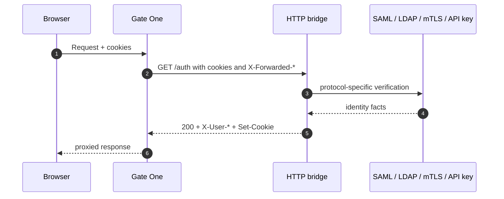

`authProvider.type: "http-bridge"` delegates request verification to an
external HTTP service: the **bridge**. The bridge adapts a technology
Gate One does not implement natively — SAML, LDAP, mTLS, API keys, a
legacy session service — to three small endpoints and a login page.

Gate One never sees the upstream protocol. It only asks the bridge
whether the request is authenticated and, for MCP, whether the token
carries the required scope.

{}
The bridge returns identity facts, not routing decisions. Gate One still
enforces `auth`, `auth.identity` and MCP scope checks on every request.
A bridge may return only `X-User-Id`, or also roles, scopes and claims.
{}



> The legacy type `http` is an alias of `http-bridge`. The contract is
> the same; new configurations should use `http-bridge`.

## Endpoints

| Method | Path | Purpose |
|---|---|---|
| `GET` | `/auth` | Verify a browser/API request (cookies or `Authorization`) |
| `GET` | `/auth/mcp` | Verify an MCP bearer token and its scope |
| `GET` | `/health` | Readiness probe |
| `GET` | `/login` | Browser login page (the URL Gate One redirects to) |
| `GET` | `/logout` | Sign-out endpoint used by the injected user badge |

`baseUrl` is the bridge root. `verifyUrl`, `mcpVerifyUrl`, `healthUrl`
and `loginUrl` can override the defaults (`baseUrl + /auth`,
`/auth/mcp`, `/health`, `/login`).

Gate One redirects a browser navigation to:

```text
{loginUrl}?returnTo={absolute-url-of-the-refused-request}
```

The bridge must authenticate the user and then return the browser to
`returnTo`. Do not put a query string in `loginUrl` itself: Gate One
appends `?returnTo=...` literally.

## `GET /auth`

Gate One sends the incoming request's credentials to the bridge:

| Request header | Meaning |
|---|---|
| `Authorization` | Copied verbatim when the client sent one |
| `Cookie` | Every incoming cookie, verbatim |
| `X-Forwarded-Host` | Original host |
| `X-Forwarded-Uri` | Original URI including query |
| `X-Forwarded-Method` | Original method |

The bridge returns:

| Status | Meaning | Gate One reaction |
|---|---|---|
| `200` | Authenticated | Identity headers are read; `Set-Cookie` is relayed |
| `401` / `403` | Not authenticated | `ErrUnauthenticated`; API gets 401, navigation redirects to login |
| `3xx` | No session (auth-bridge redirects to `/login`) | Same as unauthenticated |
| `5xx` / network error | Bridge unavailable | `502 authentication_unavailable`; never a login redirect |

### Identity response headers

Defaults match auth-bridge; override them with `authProvider.headers`:

| Header | Default | Content |
|---|---|---|
| `X-User-Id` | required | Stable subject identifier |
| `X-Username` | optional | Display/login name |
| `X-Email` | optional | Email (used only for the badge/403 page) |
| `X-Roles` | optional | Comma-separated roles |
| `X-Scopes` | optional | Comma-separated scopes |
| `X-Claims` | optional | Base64(standard) JSON object of additional claims |

`Set-Cookie` response headers are relayed to the browser verbatim: a
bridge may refresh its session while verifying a request.

## `GET /auth/mcp`

Gate One sends the client `Authorization` header plus two **internal**
headers it builds itself:

| Header | Meaning |
|---|---|
| `X-MCP-Scope` | Scope required by the MCP route |
| `X-MCP-Resource` | Protected-resource identifier/audience, when configured |

The bridge must ignore client-supplied values for these headers: only
the values set by Gate One on the internal call are trusted.

| Status | Meaning |
|---|---|
| `200` | Token valid, scope satisfied; identity headers apply |
| `401` | Token missing/invalid |
| `403` | Token valid but **insufficient scope** |
| Other | Provider unavailable → 502 |

## `GET /health`

Any `2xx` means ready. A non-2xx or a network error marks the provider
unavailable. Gate One exposes `/readyz` accordingly and never redirects
to a login page when the provider itself is down.

## Cookies and session ownership

For `http-bridge`, the **bridge owns the session**. Gate One does not
create an RP session cookie and does not have a bbolt/Redis session store
for this provider. It relays `Set-Cookie` and sends the browser's cookies
back on the next verification call.

As a consequence:

* a global logout is the bridge's responsibility;
* the injected user badge navigates to `{loginUrl origin}/logout`;
* the built-in identity-403 page has no automatic "sign out" link for
  this type (there is no Gate One RP session to clear).

## Minimal adapter sketch

The bridge is deliberately small. A Python/Flask sketch for a legacy
session service:

```python
from flask import Flask, request, make_response
import base64, json

app = Flask(__name__)

@app.get("/auth")
def auth():
    session = request.cookies.get("legacy_session")
    if not session or not legacy_sessions.valid(session):
        return "", 401
    user = legacy_sessions.user(session)
    resp = make_response("", 200)
    resp.headers["X-User-Id"] = user.id
    resp.headers["X-Username"] = user.name
    resp.headers["X-Roles"] = ",".join(user.roles)
    resp.headers["X-Claims"] = base64.b64encode(
        json.dumps({"department": user.department}).encode()
    ).decode()
    return resp

@app.get("/health")
def health():
    return {"status": "ok"}
```

A complete example is
[`examples/http-bridge/routes.json`](/examples/http-bridge/routes.json).
Configure:

```json
{
  "authProvider": {
    "type": "http-bridge",
    "baseUrl": "http://legacy-bridge:8080",
    "loginUrl": "http://legacy-bridge:8080/login",
    "headers": {
      "userId": "X-User-Id",
      "username": "X-Username",
      "roles": "X-Roles",
      "claims": "X-Claims"
    }
  },
  "routes": [{
    "host": "app.example.com", "path": "/*", "frontend": true,
    "backend": "http://app:8080", "auth": {}
  }]
}
```

## Security requirements

* Run the bridge on an internal network; never expose it through the
  public ingress. Gate One is its only client.
* Do not trust `X-Forwarded-*` from an external client; Gate One sets
  them on the internal call, but a publicly reachable bridge would let an
  attacker forge them.
* Validate cookies/tokens with the upstream technology; never return
  identity headers for an unauthenticated request.
* Return `5xx` only for bridge/upstream outages; use `401`/`403` for
  credential and scope failures so Gate One does not turn an outage into
  a login loop.
* Keep `X-MCP-Scope` / `X-MCP-Resource` handling internal: Gate One
  overwrites them on the outbound call, but the bridge must not accept
  them from an arbitrary client.

## What the contract is not

* It is not an OIDC/OAuth discovery endpoint: use `type: "oidc"` for
  that.
* It is not implemented by the `cladone-auth` **IAM**. The IAM is an
  OIDC issuer/IAM and Gate One connects to it with `type: "oidc"`; it
  does not expose `/auth`, `/auth/mcp` or `/health`. **auth-bridge** is
  the reference implementation of this request-verification contract;
  its source is `services/auth-bridge` in the Gate One source repository.
* It is not the `tokenBroker` block. That service supplies per-user
  upstream credentials for `upstream.tokenBroker`; it is unrelated to
  authentication provider selection.
