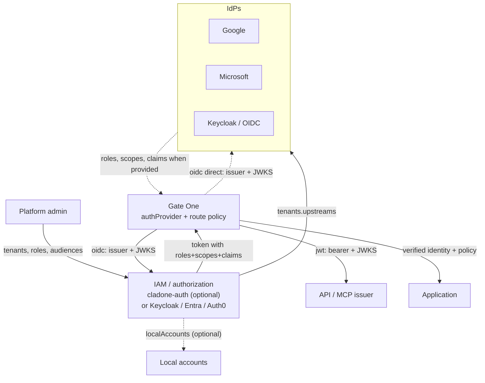
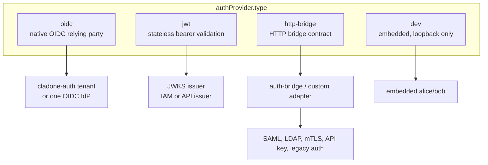
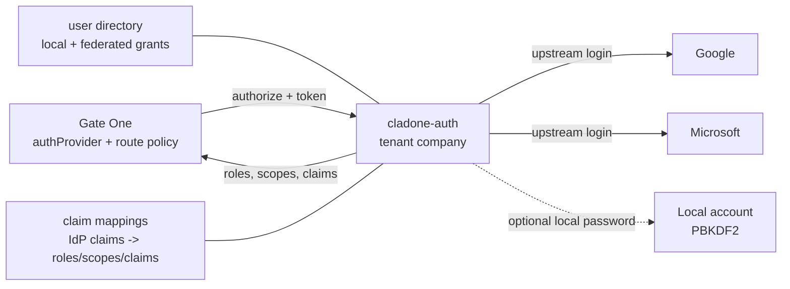

**IAM** services cover authorization and configure the identity providers (**IdPs**) they trust.

Gate One sits between the user, an IAM/authorization source and an IdP.
The schema's `authProvider.type` is a **provider type**: it selects who
Gate One asks to verify a request and obtain identity/authorization
claims. It is not an IAM by itself.

`auth.identity` is where Gate One enforces route policy. An IdP that also
carries roles, scopes and claims is acting as the IAM for that
deployment; Gate One still does not store users or assign rights.

## The three roles

| Role | Question it answers | Examples |
|---|---|---|
| **IAM / authorization** | What is this account allowed to do? Which tenants, roles, audiences and token lifetimes apply? | `cladone-auth`, Keycloak, Entra ID, Auth0, Okta |
| **IdP / identification** | Who is this human? | Google, Microsoft, Keycloak as an upstream IdP, a corporate LDAP/SAML directory |
| **Gate One / enforcement** | Is this request authenticated, and does it satisfy the route policy? | `authProvider`, `auth.identity`, MCP scope checks |

An IAM can also be an IdP: Keycloak, Entra ID and Auth0 all do both.
Gate One connects to the IAM, and the IAM configures the IdPs it trusts.

## Who configures whom

Two valid shapes:

1. **With a separate IAM (recommended for several IdPs).** The IAM owns
   the upstream IdP configuration (`tenants[].upstreams`), local policy,
   user grants and token issuance. Gate One points at the IAM with one
   `oidc` provider.
2. **Without a separate IAM.** Gate One points directly at one OIDC
   provider that acts as both the IdP and the IAM/authorization server.
   It authenticates the user and emits the roles, scopes and claims Gate
   One enforces. This is simpler, but the provider must supply the claims
   your routes need. See the
   [Direct OIDC example](/docs/examples/direct-oidc/).

In both shapes, Gate One enforces `auth.identity` per route; the IAM does
not decide which application route a user may call. An IdP that only
authenticates (for example a plain Google login) does not provide
application roles; use an IAM/broker or another claim source if you need
them.

## Provider types

| Type | Gate One talks to | Browser login | Session owner | Use when |
|---|---|---|---|---|
| `oidc` | An OIDC issuer: `cladone-auth` tenant or one IdP/IAM | Yes | Gate One (bbolt/Redis) | You have an OIDC issuer, or you use the broker |
| `jwt` | A JWKS endpoint | No | Stateless | APIs and MCP machine clients |
| `http-bridge` | A service implementing the Gate One HTTP bridge contract | Yes, on the bridge | The bridge | The technology is not OAuth/OIDC, or you already run auth-bridge |
| `dev` | The embedded loopback-only IdP | Yes | Gate One (local) | Onboarding and tests only |

`http` is accepted as a **deprecated alias** of `http-bridge` so existing
configurations keep working. New configurations should use
`http-bridge`.

### `oidc`

Gate One is the OpenID Connect relying party: discovery, authorization
code + PKCE, state/nonce, JWKS, signed session, RP-initiated and
back-channel logout. It hosts the login surface on `loginBaseUrl`.

Use it for a direct OIDC IdP or for a `cladone-auth` tenant. This is the
only provider type that combines a browser session with local revocation
state (bbolt or Redis).

### `jwt`

Gate One validates a bearer token against a JWKS. It never hosts a login
page and never issues a token. Use it for APIs and MCP clients, not for a
browser session.

### `http-bridge`

Gate One delegates verification to an HTTP service that implements the
**Gate One HTTP bridge contract**. The bridge is where non-OIDC
technologies are adapted: SAML, LDAP, mTLS, API keys, a legacy session
service, or auth-bridge in front of Keycloak.

Gate One only calls `/auth`, `/auth/mcp` and `/health`, and redirects the
browser to the bridge's login page. The bridge owns the protocol and,
usually, the session cookie. See
[the HTTP bridge contract](/docs/components/bridge-contract/) for endpoints, headers
and status codes.

### Broker, bridge and token broker

These names are easy to confuse:

| Name | What it is | Gate One talks to it via |
|---|---|---|
| `cladone-auth` **Broker** | Optional embedded IAM and OIDC issuer: IdP federation, users, claims, grants and tokens | `authProvider.type: "oidc"` |
| **`http-bridge`** | Provider type for a service that verifies requests and returns identity/IAM facts | `authProvider.type: "http-bridge"` |
| **auth-bridge** | Reference implementation of the `http-bridge` contract, often in front of Keycloak | `authProvider.type: "http-bridge"` |
| **`tokenBroker`** | Internal per-user credential service used by `upstream.tokenBroker` | Internal API, not an `authProvider` |

The Broker does **not** implement the HTTP bridge contract. It speaks
OIDC and issues tokens; Gate One is the OIDC relying party. The bridge
contract is a request-verification contract and the bridge owns the
session for that provider type.

See [Embedded IAM](/docs/features/embedded-iam/) for the Broker,
[Delegated credentials](/docs/features/delegated-credentials/) and
[Token broker](/docs/components/token-broker/) for the per-user credential service,
and [HTTP bridge contract](/docs/components/bridge-contract/) for the bridge.

### `dev`

The embedded provider exists for onboarding and tests. It is loopback
only, has real alice/bob accounts, and must not be exposed to a network.

## Internal OAuth IAM: `cladone-auth`

`cladone-auth` is the optional internal OAuth/OIDC IAM. It is a small
multi-tenant issuer with a broker-side user directory:

* it federates external IdPs (Google, Microsoft, Keycloak, …) configured
  per tenant under `tenants[].upstreams`;
* it applies local policy: tenant, roles, audiences, allowed domains,
  admin emails, claim mappings and user grants;
* it stores **one external identity link** `(issuer, subject)` per
  federated user; it never recreates the IdP account;
* local and federated users both carry `roles`/`scopes`/`claims`, managed
  by the admin CLI;
* it emits its own Ed25519-signed ID/access/refresh tokens and publishes
  JWKS and discovery;
* it publishes the revocation keyspace Gate One reads for a global
  logout.

It is deliberately lighter than Keycloak: one Go binary, one JSON file,
Redis optional for multi-instance state, no realm/theme/admin console to
operate. That makes it a good fit when you need several IdPs, normalized
rights or local policy, but do not need a full IAM suite.

The recommended path is **external IdPs**: there is no password store to
protect and no password-hash cost at login. Local accounts
(`localAccounts`) are optional for small deployments; they use PBKDF2
and add the operational burden of a credential store.

Claim mappings are evaluated on every federated login. Per-user grants
are applied to both local and federated users, and changes take effect at
the next login.

Configuration:

* [Embedded IAM feature](/docs/features/embedded-iam/)
* [Embedded IAM example](/docs/examples/embedded-iam/)
* [Broker configuration reference](/docs/config/broker/)

## `cladone-auth` vs auth-bridge

Both can serve the same users, but they sit on **opposite sides of OIDC**:

* **`cladone-auth` is an OIDC issuer and IAM.** It federates upstream
  IdPs, holds the user directory, applies claim→rights policy and issues
  its own tokens. Gate One is the relying party (`type: "oidc"`).
* **auth-bridge is an OIDC relying party and bridge.** It runs the OIDC
  flow against Keycloak and answers Gate One with identity headers per the
  bridge contract (`type: "http-bridge"`). It does not issue tokens.

| Capability | `cladone-auth` | auth-bridge |
|---|---|---|
| Gate One provider type | `oidc` | `http-bridge` |
| Role | OIDC **issuer** + IAM | OIDC **client/RP** + forwardAuth bridge |
| Emits tokens (discovery, JWKS) | yes (Ed25519) | no — returns identity headers |
| Who verifies each request | Gate One (validates the JWT) | the bridge (`/auth`) |
| Session owner | Gate One (bbolt/Redis) | the bridge (cookies) |
| Upstream IdPs | N per tenant (`upstreams`) | one: Keycloak |
| User directory | built-in (local + federated JIT) + CLI | none (Keycloak) |
| Claim → roles/scopes/claims | `mappings` + `rules` | Keycloak mappers/groups |
| Multi-tenant | yes (`tenants`) | no (one realm) |
| Local password login | optional (`localAccounts`) | delegated to Keycloak |
| MCP bearer | Gate One validates the JWT | `/auth/mcp` (bridge checks scope) |
| Global logout | back-channel + Redis revocation | front+back-channel + JSON file |
| Non-OIDC upstreams (SAML/LDAP/mTLS/API key) | no | yes — the contract is generic |
| Ops footprint | one Go binary + JSON (+Redis) | Node service + Keycloak |

The crux is the **trust direction**:

* with `cladone-auth`, Gate One is the relying party and the broker is the
  issuer — Gate One holds the session and enforces `auth.identity` from the
  **signed token**; the broker is the policy point;
* with auth-bridge, the bridge is the relying party and Keycloak is the
  issuer — Gate One enforces policy from the bridge's **identity headers**.

**What is *not* a difference: the token broker.** Delegated upstream
credentials are a separate internal service. Gate One injects the per-user
token on `upstream.tokenBroker` routes and serves its browser routes
(`tokenBroker.browserHost`) for **either** provider. It is therefore not a
reason to choose one over the other — see
[Delegated credentials](/docs/features/delegated-credentials/).

**Choosing:** use `cladone-auth` when you want several IdPs, normalized
rights, a small built-in user directory and one Go binary; use auth-bridge
when the upstream is Keycloak (or a non-OIDC technology via a custom
bridge) and you already run that stack.

## Choosing a type

| If you need… | Use |
|---|---|
| One OIDC issuer that is also the IAM, browser login, Gate One session | `oidc` |
| Several IdPs, normalized rights or managed user grants | `oidc` to `cladone-auth` |
| Bearer tokens for APIs or MCP, no browser session | `jwt` |
| SAML, LDAP, mTLS, API keys, or an existing auth-bridge | `http-bridge` |
| A local demo without external services | `dev` only |

## Related

* [Architecture](/docs/architecture/)
* [HTTP bridge contract](/docs/components/bridge-contract/)
* [Multiple identity providers](/docs/features/multiple-idps/)
* [Plugins](/docs/extending/plugins/)
